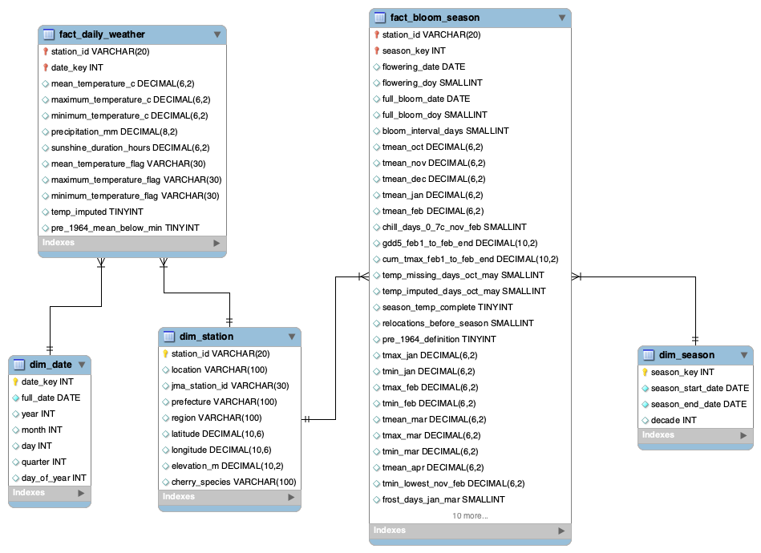

# Sakura Yosoku — MySQL warehouse (`sakura_dw`)

Everything about the MySQL star schema: how to build it, what each SQL file
does and what results to expect. **Building models does not need any of
this** — see the [main README](../README.md).

All commands are run from the project folder (`sakura_analytics/`).
Windows: type `python` instead of `python3`.

Contents
1. [Star schema](#1-star-schema-sakura_dw)
2. [Building the database](#2-building-the-database)
3. [SQL files](#3-sql-files)
4. [What `04` checks](#4-what-04-checks)
5. [Why `05` recomputes the features](#5-why-05-recomputes-the-features)
6. [How the CSVs behind the database were made](#6-how-the-csvs-behind-the-database-were-made)
7. [Expected results](#7-expected-results)
8. [Troubleshooting](#8-troubleshooting)

---

## 1. Star schema (`sakura_dw`)



Files in [`star_schema/`](star_schema/): `Sakura_Star_Schema.png`
(the diagram above) and `Sakura_Warehouse.mwb` (open in MySQL Workbench via
File → Open Model).

| Table | Grain | Rows |
|---|---|---|
| `dim_station` | station (102: 82 Somei-yoshino + 20 other species) | 102 |
| `dim_date` | calendar day 1952-01-01 … 2025-12-31 | 27,029 |
| `dim_season` | bloom season *Y* = 1 Oct (*Y*−1) … 30 Jun *Y*, 1953–2025 | 73 |
| `fact_daily_weather` | station × day (82 Somei-yoshino stations) | 2,216,378 |
| `fact_bloom_season` | station × bloom season: flowering / full-bloom dates and seasonal weather features | 5,986 |

Model layer (derived from the star schema by `05`, rebuilt at any time):

| Table | Content |
|---|---|
| `ref_cv_split` | one row per bloom year 1964–2025: `split`, `fold1`–`fold5` |
| `model_features_feb1` | Feb 1 feature table ([columns](../README.md#27-what-is-in-the-feature-tables)) |
| `model_features_mar1` | Mar 1 feature table ([columns](../README.md#27-what-is-in-the-feature-tables)) |

---

## 2. Building the database

### 2.1 First build

You need MySQL Server 8+ running on your computer (MySQL Workbench is only the
client — the server must also be installed and started) and the Python setup
from the main README (section 2.1).

```bash
python3 sql/setup_database.py
```

It asks for your MySQL username and password once, then:

1. runs `sql/01_create_star_schema.sql` (database + 5 tables);
2. loads `dim_station`, `fact_daily_weather`, `fact_bloom_season` with
   `src/etl/load_*.py`;
3. runs `sql/03_olap_queries.sql` (analysis view);
4. runs `sql/05_model_feature_tables.sql` (model tables);
5. exports `data/model/*.csv` and verifies they match MySQL;
6. prints a PASS/FAIL table of 26 health checks (the checks from `02` and
   `04` plus split / leakage / NULL checks).

Expect about 5–15 minutes; most of it is loading 2.2 million weather rows.
Success ends with `✓ All checks passed`. In MySQL Workbench, refresh the
schema list to see `sakura_dw`.

You never need to open the five SQL files one by one; the script runs them
in the right order. They are still there to read or to run single queries.

### 2.2 Other commands

| Command | When |
|---|---|
| `python3 sql/setup_database.py --checks` | Check an existing database (read-only) |
| `python3 sql/setup_database.py --model-tables` | You already have `sakura_dw` and only need the new or updated model tables and CSVs (e.g. after pulling a change to `05`) — about 1 minute |
| `python3 sql/setup_database.py --reset` | Delete `sakura_dw` and rebuild everything |

If you changed data or SQL and the CSVs in `data/model/` changed, commit them
so Python-only teammates get the update.

### 2.3 Saving your password (optional)

Copy `sql/.env.example` to `sql/.env` and fill in your password; scripts then
stop asking, and `load_features()` reads from MySQL instead of the CSVs. `.env` is
git-ignored — never commit it.

---

## 3. SQL files

| File | What it does | Changes data? |
|---|---|---|
| `01_create_star_schema.sql` | Creates `sakura_dw` and the five tables; fills `dim_date` and `dim_season`. Only on a server without `sakura_dw` — fails if the tables exist. | Yes |
| `02_validation.sql` | Row counts, coverage, missing targets, duplicate keys, foreign keys. | No |
| `03_olap_queries.sql` | Descriptive OLAP queries (bloom timing by region, decade, earliest stations, January temperature, imputation by region) and the `vw_sakura_march1_features` view. | Creates a view |
| `04_season_integration_validation.sql` | Season mapping, grain and feature-consistency checks ([section 4](#4-what-04-checks)). | No |
| `05_model_feature_tables.sql` | Builds the model layer with explicit forecast-date cutoffs. Safe to re-run. | Rebuilds 3 model tables |

To run one file by hand in Workbench: File → Open SQL Script → ⚡ Execute.
For `04`, raise the result-row limit first (B1 lists ~26,000 rows).

---

## 4. What `04` checks

Bloom outcomes are one row per station-season while weather is daily, so
wrong joins or aggregations would silently distort features. `04` is
read-only and checks:

| Section | Check | Why it matters |
|---|---|---|
| B1 | Maps each date to an Oct–Jun bloom season | Oct–Dec weather must count toward the *following* bloom year |
| B2 | Dates in more than one season (expect 0 rows) | One weather day must not feed two seasons |
| B3 | Null or reversed season boundaries (expect 0 rows) | Invalid windows distort features |
| C1 | Aggregates Dec–Feb weather to station-season *before* joining bloom data | Shows the correct grain; joining daily rows to bloom rows multiplies targets. Descriptive only — Dec–Feb is not available on Feb 1 |
| C2 | Duplicate keys in both fact tables (expect 0 rows) | Each fact table keeps its grain |
| A1 | Recomputes Jan–Apr mean temperature from daily data and compares with the stored values | Catches processing / rounding errors |
| A2 | Same for Feb–Mar precipitation and sunshine totals | Same, for the other weather features |
| A3 | Stations with missing Jan/Feb mean temperature | Shows where gaps concentrate |

Results: `MATCH` = within 0.011; `MISMATCH` = investigate (do not overwrite
automatically); `MISSING` = one side is empty.

---

## 5. Why `05` recomputes the features

Several stored columns in `fact_bloom_season` are not safe for the agreed
forecast dates:

- `chill_days_0_7c_nov_feb` and `tmin_lowest_nov_feb` include February
  (not allowed on Feb 1);
- `season_temp_complete` uses Oct–May completeness, and `gdd5_*` / `cum_*`
  were emptied when any Feb–May day was missing — information from after the
  forecast date;
- `rule600_*` / `rule400_*` need temperatures after Mar 1.

`05` recomputes every feature from `fact_daily_weather` with an explicit date
cutoff and decides row completeness only from days up to the cutoff. Where the
definitions are the same, the values equal the stored ones exactly.
`vw_sakura_march1_features` (from `03`) is kept for descriptive analysis only.

---

## 6. How the CSVs behind the database were made

`src/01_prepare_source_data` downloads and combines JMA station weather;
`src/02_preprocess/02_clean_weather_and_features.py` applies quality codes,
imputes short temperature gaps from neighbouring stations, and writes the
cleaned files in `data/processed/02_cleaned_source_data/weather/` (details in
the README there and the EDA report in `reference/`).

---

## 7. Expected results

From a fresh build on MySQL 8.0 (2026-10-16):

- Row counts: 102 / 27,029 / 73 / 2,216,378 / 5,986; 825 missing full-bloom
  dates; 0 duplicate keys; 0 foreign-key orphans.
- `04`: A1 — Jan, Feb, Mar 5,942 MATCH / 44 MISSING, Apr 5,943 / 43,
  0 MISMATCH; A2 — precipitation 5,944 MATCH / 42 MISSING, sunshine 5,376 MATCH
  / 610 MISSING, 0 MISMATCH; B2, B3, C2 return no rows.
- Model tables: 4,365 rows each (3,837 development, 528 test); no empty
  values; no full bloom on or before Mar 1 (earliest is day 78).
- Climatology baseline, mean of 5 validation folds: MAE 3.96, RMSE 4.69,
  R² 0.80, ±3-day hit rate 0.44.

---

## 8. Troubleshooting

| Message | Fix |
|---|---|
| `Can't connect to MySQL server on 'localhost'` | The MySQL server is not running. macOS: System Settings → MySQL → Start. Windows: Services → MySQL80 → Start. (Modelling still works from the CSVs.) |
| `Access denied for user ...` | Wrong MySQL username or password — use the ones you use in MySQL Workbench |
| `'cryptography' package is required` or `No module named ...` | `python3 -m pip install -r requirements.txt` |
| `Database 'sakura_dw' already exists` | Use `--checks`, `--model-tables` or `--reset` ([section 2.2](#22-other-commands)) |
| A health check shows FAIL | Run `python3 sql/setup_database.py --reset` once; if it still fails, share the PASS/FAIL table with the team |
| Error 1175 "safe update mode" when running `05` by hand | Pull the latest `05`; it switches safe-update mode off for itself |
